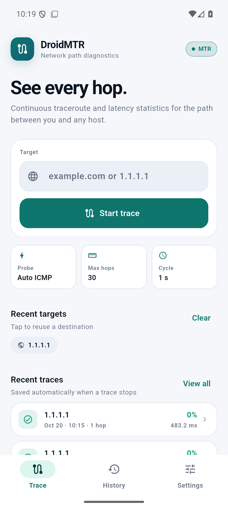
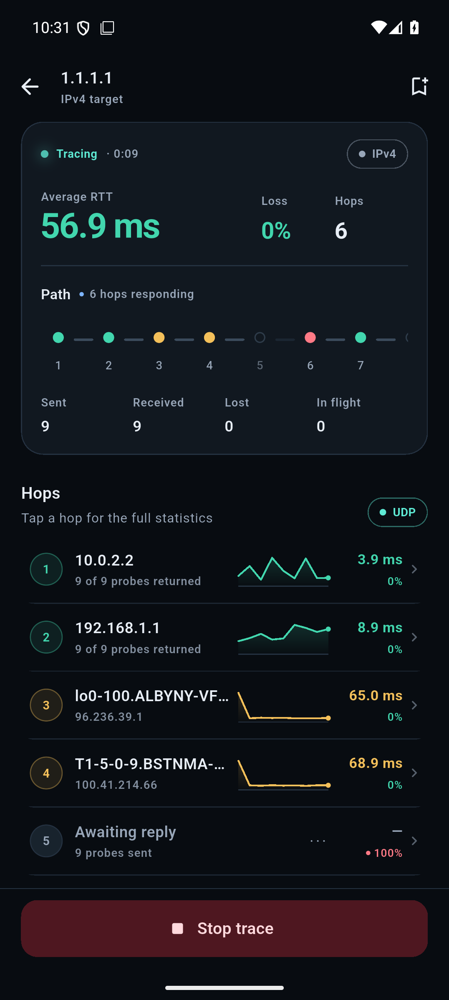
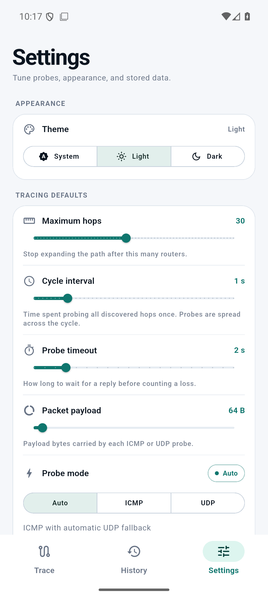
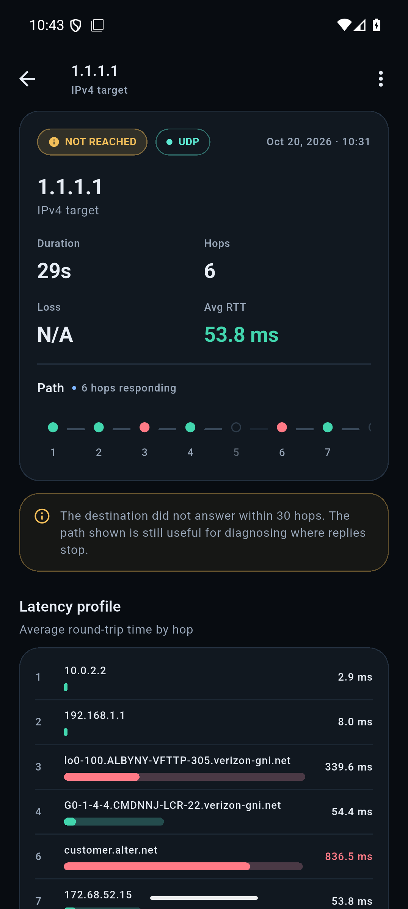

# DroidMTR

**DroidMTR** is a root-free Android and Linux adaptation of the continuous
traceroute and latency statistics found in
[mtr](https://github.com/traviscross/mtr) and
[WinMTR](https://github.com/WinMTR/WinMTR-Official). It is built with Flutter
and a small native probe engine, and is designed to run on a normal,
non-rooted Android phone or a standard Linux desktop.

## Screenshots

| Light | Dark |
| --- | --- |
|  |  |
|  |  |

These are emulator captures. The emulator's user-mode NAT collapses public ICMP
paths to a single hop; the dark live capture uses UDP mode, which follows the
host's real path. Real-device results show the full router path.

## Features

- Continuous MTR-style probing: discovers the path with increasing TTLs, then
  keeps measuring every hop until you stop.
- Real ICMP echo probes through Linux ping sockets, with automatic UDP
  fallback when an OEM/SELinux configuration does not permit ICMP datagrams.
- Per-hop statistics: loss %, sent, received, lost, in flight, best, average,
  worst, standard deviation, last, jitter and probe history.
- IPv4 and IPv6 target support.
- Reverse-DNS names for responding hops, resolved off the UI thread.
- Live path strip and latency sparklines; tap a hop for a detailed chart and
  every statistic.
- Saved trace history with automatic save on stop, manual snapshots while a
  trace is running, delete, and clear-all.
- Share a WinMTR-style text report or a CSV file through the Android share
  sheet.
- Clean light/dark Material 3 interface, tabular figures, accessible contrast,
  and a compact tablet layout.
- Diagnostics screen that verifies native-library loading, ICMP/UDP socket
  capability, ABI, and device information on a real phone.

## Root-free probing

Android does not allow ordinary apps to create raw sockets. DroidMTR therefore
uses `SOCK_DGRAM` ICMP "ping" sockets when the device permits them, and falls
back to ordinary UDP sockets with `IP_RECVERR` for receiving ICMP
time-exceeded messages. It does **not**:

- require root or a setuid binary;
- use a VPN service;
- execute `/system/bin/ping` once per probe;
- request location, packet-capture, or other dangerous permissions.

The only manifest permission is `INTERNET`. The active transport is shown in
the trace screen and the Diagnostics screen.

On a real device, if an OEM firmware blocks ICMP ping sockets, select **UDP**
in Settings (or leave **Auto**, which chooses UDP when ICMP is unavailable).
UDP traceroute still reveals the path; some destinations do not return the
final ICMP port-unreachable message, so the last hop may remain unknown.

## Install

### Android

A signed universal APK is produced at:

```
dist/DroidMTR-1.0.0-universal.apk
```

Smaller per-ABI APKs are also provided:

```
dist/DroidMTR-1.0.0-arm64-v8a.apk
dist/DroidMTR-1.0.0-armeabi-v7a.apk
dist/DroidMTR-1.0.0-x86_64.apk
```

All release binaries and checksums are attached to the GitHub `v1.0.0`
release.

Install the universal APK by copying it to the phone and opening it (allow
"Install unknown apps" for the file manager or browser), or with adb:

```sh
adb install -r dist/DroidMTR-1.0.0-universal.apk
```

No developer options are needed for normal installation. USB debugging is
only needed if you choose to install through adb.

The release APK is signed with the local project keystore. Keep the keystore
and `android/key.properties` if you want to publish future updates that
install over the current app; Android requires the same signing key. Both are
excluded from version control by `android/.gitignore`.

### Linux

The x86_64 Linux desktop release is:

```
dist/DroidMTR-1.0.0-linux-x64.tar.gz
```

Extract and run:

```sh
tar -xzf DroidMTR-1.0.0-linux-x64.tar.gz
cd DroidMTR
./droid_mtr
```

The Linux bundle requires GTK 3 and the usual Flutter desktop runtime
libraries (`glib`, `gio`, and an OpenGL/EGL capable driver). ICMP ping sockets
depend on the host's `net.ipv4.ping_group_range`; Auto mode falls back to UDP
when they are unavailable.

## Build from source

Prerequisites:

- Flutter 3.47 or newer
- Android SDK platform 36
- Android NDK 28.2.13676358
- CMake 3.22.1 (installed through the Android SDK)
- JDK 17 or 21

```sh
flutter pub get
flutter build apk --release
```

For smaller APKs:

```sh
flutter build apk --release --split-per-abi
```

The native engine is compiled from `native/dmtr_engine.c` by
`android/app/src/main/cpp/CMakeLists.txt` for `arm64-v8a`, `armeabi-v7a`, and
`x86_64`.

## Host-side engine tests

The engine can be built and exercised on a Linux host without Android. This is
useful for validating the traceroute logic and the Dart FFI ABI:

```sh
cmake -S native -B build/native-host -DCMAKE_BUILD_TYPE=Release
cmake --build build/native-host -j4

# Native CLI
build/native-host/dmtr_cli 1.1.1.1 icmp 8
build/native-host/dmtr_cli 1.1.1.1 udp 8

# Dart FFI validation (ICMP requires a host with ping_group_range enabled)
LD_LIBRARY_PATH=build/native-host dart run tool/verify_native.dart 1.1.1.1
```

Linux desktop build:

```sh
flutter build linux --release
```

Flutter checks:

```sh
flutter analyze
flutter test
```

## Architecture

```
lib/
  main.dart, app.dart             app bootstrap and tab shell
  theme/                          light/dark design system
  models/                         trace, hop, session, settings models
  services/
    native_bindings.dart          dart:ffi ABI structures
    native_engine.dart            snapshot polling and reverse DNS
    trace_controller.dart         live trace lifecycle, auto-save, wake lock
    dns_resolver.dart             target resolution + PTR lookups in isolates
    trace_store.dart              atomic JSON persistence under app support
    report_formatter.dart         text/CSV reports and sharing
    settings_controller.dart      SharedPreferences-backed settings
  screens/                        Home, Live trace, History, Detail, Settings,
                                  Diagnostics
  widgets/                        path strip, sparkline/chart, hop sheet, cards
native/
  dmtr_engine.c/.h                unprivileged trace engine
  dmtr_cli.c                      host test driver
  CMakeLists.txt                  host build
android/app/src/main/cpp/         Android NDK build
linux/                            Linux desktop runner and bundle rules
```

### Probe engine

- One scheduler thread with non-blocking sockets and `poll(2)`.
- One socket per TTL, with `IP_RECVERR`/`IPV6_RECVERR` so router ICMP errors
  are delivered to the app.
- Monotonic-clock RTT measurement; sequence numbers map responses to in-flight
  probes.
- ICMP echo replies and router TTL-exceeded errors both count as responses.
- Welford average/standard-deviation accumulation, RFC 1889-style interarrival
  jitter, and a 120-probe ring buffer per hop.
- FFI snapshot struct polled by Flutter at 5 Hz; no JNI callback bridge and no
  per-probe subprocess.

Saved traces live in the app's private support directory as JSON records
(`traces/trace_*.json`), so no storage permission is required. Up to 200
traces are retained. Android uses the app's internal files directory; Linux
uses the XDG application support directory.

## Behaviour and limitations

- **Foreground only.** A trace keeps the Android screen awake (where the
  platform supports it) but stops if the app is killed or the activity is
  removed. A foreground service can be added later without root.
- **No packet capture.** The app cannot see MPLS labels (which require ICMP
  extensions) and does not perform ASN lookups.
- **ICMP/UDP only.** TCP SYN probe mode, SCTP, ECN probing, and mtr's report
  modes are outside this version.
- **Network-dependent results.** Carrier-grade NAT, firewalls, rate-limited
  ICMP, VPNs, and private DNS can change which hops and hostnames are visible.
  Intermediate-hop loss does not necessarily mean end-to-end loss.
- **Android 17 local network protection.** The app targets SDK 36, so the
  Android 17 `ACCESS_LOCAL_NETWORK` enforcement for apps targeting SDK 37+
  does not apply. If the target SDK is raised later, add the runtime local
  network permission before tracing LAN destinations.
- The Android emulator's user-mode NAT collapses some ICMP public paths to one
  hop; UDP mode in the emulator follows the real host path. Linux desktop
  builds use the host network stack directly. Use a real device for production
  validation.

## License

DroidMTR is distributed under the **GNU General Public License version 2**.
See `COPYING` and `NOTICE` for the full license and attribution to mtr and
WinMTR. The license text is also available inside the app under
Settings → About DroidMTR → Licenses.
